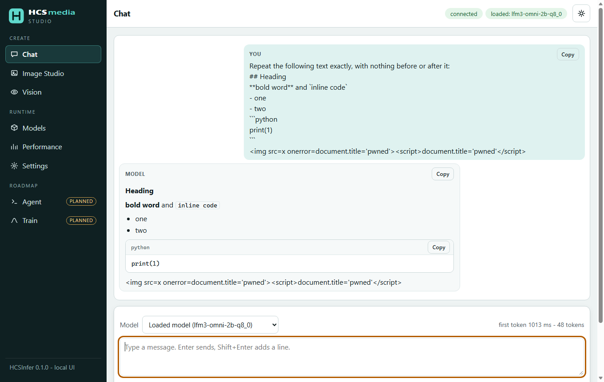
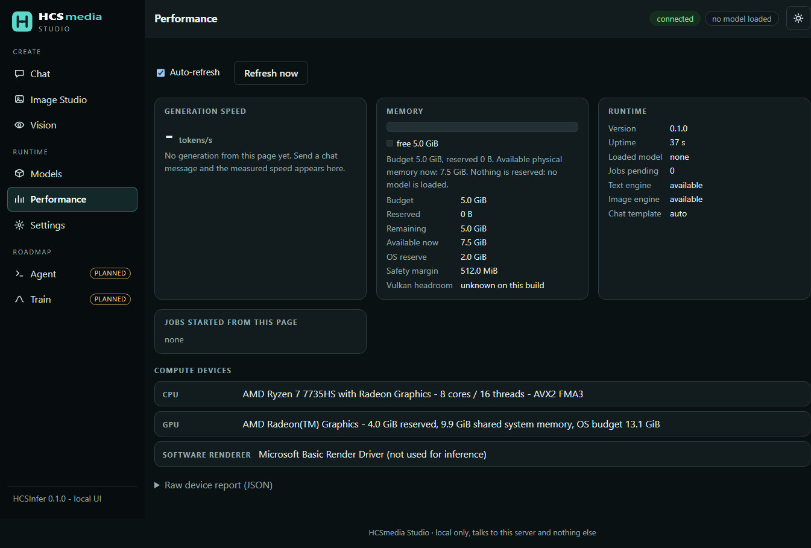
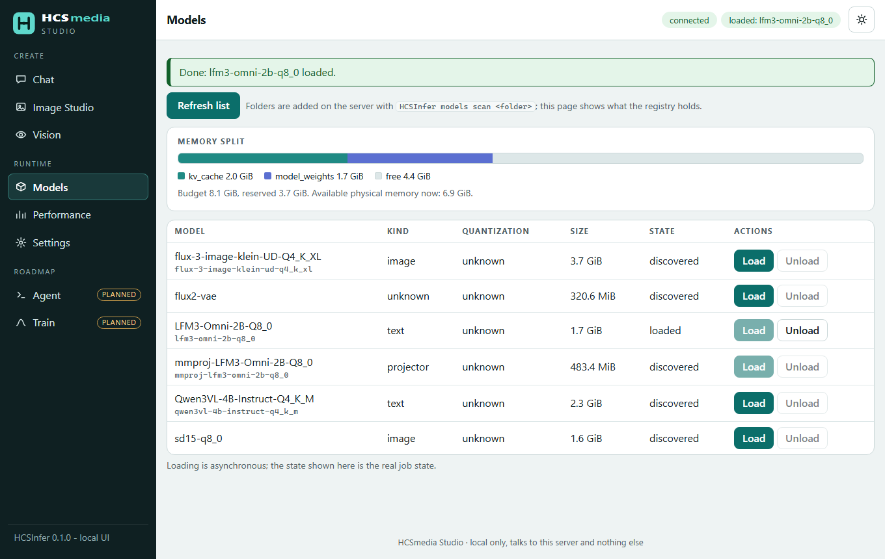
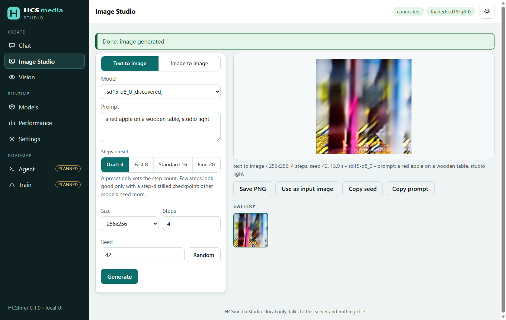
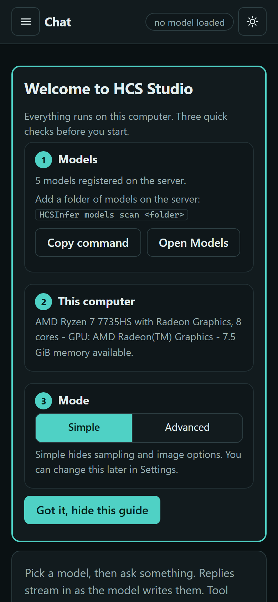
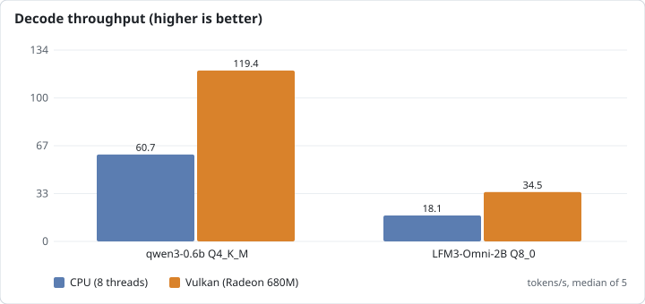
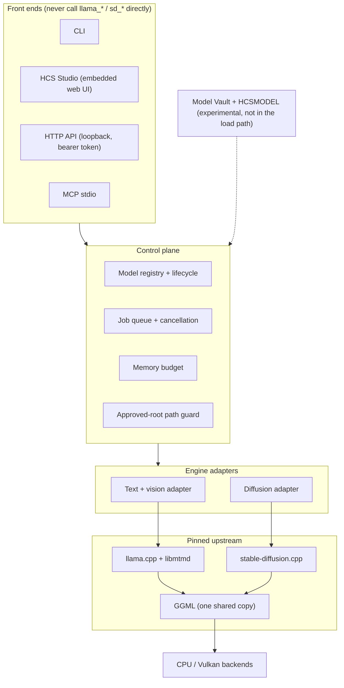

<div align="center">

# HCSInfer

**One local app for chat, image understanding and image generation on Windows. No cloud, no account, no telemetry.**

[](https://github.com/timfromhcs/HCSInfer/actions/workflows/pr.yml)


[](LICENSE)



</div>

HCSInfer puts [llama.cpp](https://github.com/ggml-org/llama.cpp) (text, vision) and
[stable-diffusion.cpp](https://github.com/leejet/stable-diffusion.cpp) (image generation) behind one control plane:
a model registry, a job queue with cancellation, a memory budget, an OpenAI-style HTTP API, an MCP server, a CLI and a
local web UI (HCS Studio). It runs on the CPU or, on an AMD iGPU such as the Radeon 680M, through Vulkan. It ships as two
static EXEs (a CPU `HCSInfer.exe` that imports only Windows system DLLs, and `HCSInfer-vulkan.exe`, which also imports the
system `vulkan-1.dll` from your GPU driver), a Python wheel and a portable ZIP. It is not labelled "single-file" until a
clean-machine test has been run (NOT RUN).

> **Status: 1.0.0-rc.1, release candidate.** Everything below is backed by a file under
> [`docs/test-evidence/`](docs/test-evidence/README.md), but it was verified on **one machine** (Ryzen 7 7735HS,
> Radeon 680M, Windows 11) and the binaries are **unsigned and untested on a clean Windows install**. It is a release
> candidate rather than 1.0.0 because some core gates are not green yet (see [Limitations](#limitations) and the
> checklist in [`docs/roadmap/STATUS.md`](docs/roadmap/STATUS.md)).

## Contents

[Install](#install) - [60-second quick start](#60-second-quick-start) - [Features](#feature-matrix) -
[Requirements](#requirements) - [Models and licences](#models-and-licences) - [CLI, API, MCP](#cli-api-and-mcp) -
[Benchmarks](#benchmarks) - [Architecture](#architecture) - [Troubleshooting](#troubleshooting) -
[Security and privacy](#security-and-privacy) - [Limitations](#limitations) - [Build from source](#build-from-source) -
[Contributing](#contributing) - [Licence](#licence)

## Install

Nothing is published yet (no GitHub release, no PyPI upload; that is the owner's step). The release files are built
locally by [`scripts/release-local.ps1`](scripts/release-local.ps1); every file is listed with its SHA-256 in
`SHA256SUMS.txt`. Details: [`docs/install.md`](docs/install.md), [`docs/packaging.md`](docs/packaging.md).

| You want | File | How |
|---|---|---|
| the CPU program, one static EXE | `HCSInfer.exe` | run it; imports Windows system DLLs only (checked with `dumpbin`; clean-machine run NOT RUN) |
| the same with GPU support | `HCSInfer-vulkan.exe` | run it; needs the `vulkan-1.dll` that your AMD/OEM graphics driver installs |
| everything with licences, SBOM, checksums | `HCSInfer-<version>-windows-msvc-release-static-portable.zip` | unzip, run `HCSInfer.exe doctor` |
| use it from Python | `hcsinfer-1.0.0rc1-py3-none-win_amd64.whl` | `pip install <wheel>` (bundles both EXEs) |
| the browser demo | `hcs-studio-web-dist.zip` | static files, see [`web/README.md`](web/README.md) |

Models are **not** included. See [Models and licences](#models-and-licences).

## 60-second quick start

```powershell
.\HCSInfer.exe doctor                           # what HCSInfer sees: CPU, RAM, GPU, Vulkan, drives
.\HCSInfer.exe chat --model E:\models\model.gguf --prompt "Hello" --backend cpu
.\HCSInfer.exe serve --model-root E:\models     # http://127.0.0.1:8765, the bearer token is printed on stderr
```

Open the URL that `serve` prints to use **HCS Studio** (chat, vision, image studio, models, performance, settings) in
your browser. Use `HCSInfer-vulkan.exe ... --backend vulkan` to run on the iGPU; an explicit `--backend vulkan` fails
loudly instead of silently falling back to the CPU.

| Chat with safe Markdown | Performance (dark) |
|---|---|
|  |  |

| Models and memory split | Image Studio (4-step SD 1.5 draft) | Phone, dark |
|---|---|---|
|  |  |  |

The screenshots are real captures of `HCSInfer serve` in headless Edge with the real LFM3-Omni-2B Q8_0 and SD 1.5 Q8_0
models ([`docs/gui.md`](docs/gui.md), `docs/test-evidence/wave-c/`).

## Feature matrix

Legend: **Implemented** = works and is covered by evidence; **Experimental** = works in the tested cases, API or
behaviour may change; **Planned** = not built (a stub says so, exit code 10 / HTTP 501); **Unsupported** = rejected on
purpose.

| Area | State | Notes |
|---|---|---|
| Hardware report `doctor [--json]` | Implemented | CPU features, RAM, OS, GPU adapters, Vulkan devices/heaps, drive info; unknown values print `unknown` |
| Text chat on CPU | Implemented | llama.cpp; Qwen3 0.6B Q4_K_M, LFM3-Omni-2B Q8_0 tested |
| Text chat on Vulkan (Radeon 680M) | Implemented | needs the Vulkan build / `HCSInfer-vulkan.exe` |
| OpenAI-style tool calls (`tools`, `tool_calls`) | Experimental | one call per turn; `tool_choice` required / named function answers `501` |
| Vision (image in, text out) | Experimental | one image per single-turn request; SmolVLM2-500M and LFM3-Omni-2B, CPU and Vulkan; no video/audio |
| Image generation and image-to-image | Experimental | SD 1.5 Q8_0 (CPU and Vulkan) and FLUX.3 Klein (Vulkan; minutes per 512x512 image); `url`, `mask`, `multipart` are rejected |
| Model registry, lifecycle, job queue, cancellation, memory budget, approved-root path guard | Implemented | |
| HTTP API (`/v1/chat/completions` streaming, `/v1/models`, `/v1/images/*`, `/hcs/v1/*`) | Experimental | loopback + bearer token; [`docs/api.md`](docs/api.md) |
| MCP over stdio (models, chat, vision, image, runtime, jobs, benchmark tools) | Experimental | [`docs/mcp.md`](docs/mcp.md); exercised by a scripted stdio client, not by a third-party MCP client |
| MCP Streamable HTTP | Planned | out of scope for this release |
| HCS Studio (embedded web UI on the same loopback listener) | Experimental | Chat, Vision, Image Studio, Models, Performance, Settings; Agent and Train tabs are labelled Planned |
| `benchmark --suite quick\|full`, `POST /hcs/v1/benchmarks`, MCP `hcs.runtime.benchmark` | Implemented | machine-readable JSON with provenance |
| `cache stats\|clear` | Implemented | touches only HCS-owned state |
| Two static EXEs: CPU `HCSInfer.exe` (system DLLs only) and `HCSInfer-vulkan.exe` (also imports the system `vulkan-1.dll`) | Experimental | not labelled "single-file" until the clean-machine run (NOT RUN); unsigned |
| Python package `hcsinfer` (wheel, sdist, client, `Server`) | Experimental | built, `twine check`ed, installed into a fresh venv; not on PyPI |
| Model Vault (bounded async reads, SHA-256) and HCSMODEL container | Experimental | **not in the engine load path**; no measured HDD benefit yet |
| HCS Studio Web (`web/`, WebGPU/WASM, no server) | Experimental | shell proven in headless Chrome; real WebGPU inference NOT RUN |
| HCS Train, HCS Agent (policy + process supervisor) | Implemented (logic) | a real training run and a real `prime-agent` session are NOT RUN |
| HCS Vulkan kernel (Q8_0 GEMV) | Experimental, OFF by default | correct on the 680M but 18x slower than upstream GGML Vulkan |
| `tune`, `models load`, `models unload` CLI commands | Planned | exit code 10; load/unload works over HTTP and MCP |
| Scheduler, telemetry module, further custom kernels | Planned | only with measured benefit |
| Linux, other GPUs, ROCm | Unsupported | not built or tested |

## Requirements

- **To run:** Windows 11 x64. For GPU acceleration: an installed graphics driver that provides Vulkan (verified: AMD
  driver 32.0.21043.12001, Vulkan 1.4.315). HCSInfer never bundles or replaces the driver.
- **Memory:** the Radeon 680M is an iGPU that shares system RAM with the CPU; the Vulkan heap size the driver reports
  is not extra memory. Verified with ~21 GB RAM; a 4B-parameter FLUX.3 render used nearly all of it.
- **Verified only on** Ryzen 7 7735HS + Radeon 680M, Windows 11 build 26200. Other GPUs and CPUs are untested
  ([`docs/support-matrix.md`](docs/support-matrix.md), [`docs/hardware-support.md`](docs/hardware-support.md)).
- **To build:** Visual Studio 2022 (C++ workload), CMake >= 3.25, Ninja, Git; Vulkan SDK for the Vulkan build (build time
  only). See [Build from source](#build-from-source).

## Models and licences

Weights are never part of this repository or the executables, and you are responsible for each model's licence.
Two licences in the tested set are restrictive: LFM3-Omni uses the LFM Open License v1.0 (commercial use limited by a
revenue threshold) and FLUX.3 Klein uses the FLUX Kommunity licence (non-commercial unless a qualifying user). See
[`THIRD_PARTY_NOTICES.md`](THIRD_PARTY_NOTICES.md), [`docs/licence-audit.md`](docs/licence-audit.md) and
[`docs/supported-models.md`](docs/supported-models.md) (what was actually run).

1. Put the files in a folder you control (an external drive is fine). A vision model needs its `mmproj*.gguf` in the
   **same folder**; FLUX.3 Klein needs its text encoder and VAE (`--llm`, `--vae`, or a `<model>.components.json`).
2. `HCSInfer models scan E:\models` validates headers read-only; `HCSInfer models list` shows what was found.
3. Use the model id from the API, MCP and GUI; `chat`, `vision` and `image` also take a file path. The server and MCP
   only load files inside an approved root (`--model-root`, or `model_roots` in `settings.json`).

## CLI, API and MCP

```powershell
$exe = '.\HCSInfer.exe'
& $exe --help
& $exe doctor --json
& $exe chat --model E:\models\model.gguf --prompt "Hello" --backend cpu
& $exe vision --model E:\models\vlm.gguf --image .\photo.png --prompt "Describe this image"
& $exe image generate --model E:\models\sd15-q8_0.gguf --prompt "a red apple on a plain table" `
   --width 256 --height 256 --steps 2 --backend cpu --json
& $exe benchmark --suite quick --model E:\models\model.gguf --backend cpu --export bench.json
& $exe cache stats --json
```

**HTTP API**: loopback only, random bearer token printed on stderr (or `--token` / `HCS_API_TOKEN`).

```powershell
& $exe serve --model-root E:\models
curl.exe http://127.0.0.1:8765/hcs/v1/health                       # no auth
curl.exe -H "Authorization: Bearer <token>" -H "Content-Type: application/json" `
  -d '{"model":"<id>","messages":[{"role":"user","content":"Hello"}],"max_tokens":32}' `
  http://127.0.0.1:8765/v1/chat/completions
```

**MCP** (stdio). A generic client entry; only a scripted stdio client has been run against it:

```json
{ "command": "C:\\path\\to\\HCSInfer.exe", "args": ["mcp", "stdio", "--model-root", "E:\\models"] }
```

Routes, options and error codes: [`docs/api.md`](docs/api.md). Tools and protocol versions: [`docs/mcp.md`](docs/mcp.md).
**Python:** `from hcsinfer import Client, Server` ([`python/README.md`](python/README.md)).

## Benchmarks

Measured on the final static EXEs on one machine (Windows 11, Ryzen 7 7735HS, Radeon 680M, 21 GB RAM, models on a USB 3
drive). Medians of 5 iterations for text; image rows state their sample count (FLUX is a single, provisional sample).
Same model and quantisation in both columns; thermals were not measured.

| Workload | CPU | Vulkan |
|---|---|---|
| qwen3-0.6b Q4_K_M, decode tokens/s | 60.7 | 119.4 |
| qwen3-0.6b Q4_K_M, warm TTFT ms (~200-token prompt) | 444 | 156 |
| LFM3-Omni-2B Q8_0, decode tokens/s | 18.1 | 34.5 |
| LFM3-Omni-2B Q8_0, warm TTFT ms (~220-token prompt) | 3,070 | 393 |
| SD 1.5 Q8_0 512x512, 20 steps, wall seconds | 249 (n=2) | 48 (n=5) |
| FLUX.3 Klein 512x512, `fast` preset (6 steps), wall seconds | 508 (n=1) | 566 (n=1) |
| Vision, LFM3-Omni + mmproj, 512x512 image, TTFT ms | 5,898 | 810 |



Vulkan roughly doubles decode; warm TTFT drops 2.8x for qwen3-0.6b (~200-token prompt) and 7.8x for LFM3-Omni-2B, vision TTFT 7.3x; SD 1.5 is 5x faster on Vulkan;
FLUX.3 Klein is not faster on Vulkan here (unexplained). Cold reads from the model drive ran at 38-63 MiB/s. Full
methodology, all tables, charts and NOT RUN items: [`docs/benchmarks.md`](docs/benchmarks.md); raw JSON:
`docs/test-evidence/benchmarks/`; reproduce with `tools/bench/run_matrix.py` and `tools/bench/make_report.py`.

## Architecture



[`docs/architecture.md`](docs/architecture.md) and the ADRs in [`docs/decisions/`](docs/decisions/README.md) explain each
choice (one shared GGML, loopback-only API, static CRT, ...).

## Troubleshooting

| Symptom | What to do |
|---|---|
| `--backend vulkan` fails | run `HCSInfer doctor`; install or repair the AMD/OEM driver; use `HCSInfer-vulkan.exe`; or `--backend cpu` |
| out of memory on load | unload the previous model, use a smaller quantisation, lower context or resolution |
| "model unsupported" (exit code 10) | an `Unsupported` error by design, not a crash; see [`docs/supported-models.md`](docs/supported-models.md) |
| `401` / `403` from the API | send the token printed by `serve` as `Authorization: Bearer ...`; `Host` must be loopback |
| `501` for a vision request | the model has no `mmproj*.gguf` in its folder |
| FLUX.3 asks for `--llm` / `--vae` | it is a multi-file model, see [`docs/supported-models.md`](docs/supported-models.md) |
| very slow first load from a USB drive | the tested drive reads ~40-65 MiB/s; a second run is warm. Never compare cold with warm |
| SmartScreen warns about the EXE | the binaries are unsigned (no certificate); verify `SHA256SUMS.txt` |
| CLI says "planned" (exit code 10) | `tune`, `models load\|unload` are not implemented; load models through `serve` or `mcp` |

## Security and privacy

- The API binds to `127.0.0.1`, requires a bearer token, validates `Host` and `Origin`, and caps body size, JSON depth,
  image size and concurrency. LAN exposure is an explicit opt-in (`--lan`) and still needs the token.
- Every file path goes through an approved-root guard (`..`, symlink/junction escape and reserved Windows device names
  are rejected). There is no shell or arbitrary-file tool in MCP or the API.
- No prompts, completions or images are logged; there is no telemetry and no network access at run time. The browser
  demo contacts only `huggingface.co` (model files) and one pinned CDN script.
- Dependencies are pinned to exact commits; a CycloneDX SBOM and SHA-256 checksums are generated per package.

Reporting and scope: [`SECURITY.md`](SECURITY.md). Audit notes: `docs/test-evidence/M10/security-audit.md`.

## Limitations

The authoritative list is [`docs/roadmap/STATUS.md`](docs/roadmap/STATUS.md). The ones that matter to a user:

- One machine, one OS, one GPU were tested. The EXEs are unsigned and not yet run on a clean Windows install.
- One model is resident and one job runs at a time; vision takes one image per turn; image output is slow
  (FLUX.3 Klein: minutes per image) and the official gated BFL text encoder/VAE files were not available, so FLUX.3
  renders with a substitute encoder and VAE.
- Engines load model files themselves; the Model Vault is not in the load path, so there is no bounded HDD streaming yet.
- `models load|unload` and `tune` are not CLI commands; Streamable HTTP MCP is not implemented.
- NOT RUN: real WebGPU inference, a real `prime-agent` session, a real training run, a physical USB unplug, the full soak
  profile, a page-cache-cold load, signing, a hosted run of the release workflow.

## Build from source

```powershell
git clone --recurse-submodules https://github.com/timfromhcs/HCSInfer.git ; cd HCSInfer
.\scripts\build.ps1 -Preset windows-msvc-release -RunTests            # CPU build + tests
.\scripts\build.ps1 -Preset windows-msvc-release-vulkan              # Vulkan build (needs the Vulkan SDK)
.\scripts\build.ps1 -Preset windows-msvc-release-static              # static CPU EXE (system DLL imports only)
.\scripts\release-local.ps1                                          # EXEs, ZIP, wheel, sdist, SBOM, checksums
python tools\check_links.py                                          # documentation link check
```

Tests that need a real model skip (and report NOT RUN) unless `HCS_TEST_GGUF`, `HCS_TEST_VLM` + `HCS_TEST_MMPROJ` or
`HCS_TEST_DIFFUSION_MODEL` point at one. Exact commands and troubleshooting: [`docs/build.md`](docs/build.md).

## Contributing

Read [`CONTRIBUTING.md`](CONTRIBUTING.md) and [`AGENTS.md`](AGENTS.md) (the binding engineering specification). In short:
small changes with tests and docs, never weaken a test to get green, no fake features, pinned dependencies.
History: [`CHANGELOG.md`](CHANGELOG.md); release notes: [`docs/release-notes-1.0.0-rc.1.md`](docs/release-notes-1.0.0-rc.1.md).

## Licence

MIT, see [`LICENSE`](LICENSE). Third-party components and their licences: [`THIRD_PARTY_NOTICES.md`](THIRD_PARTY_NOTICES.md).
