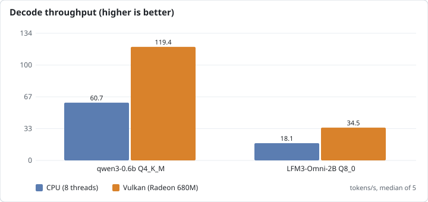
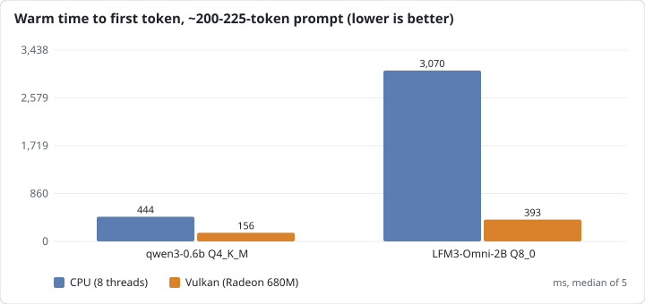
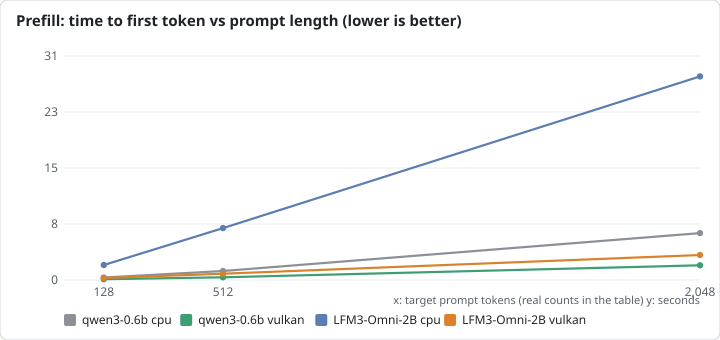
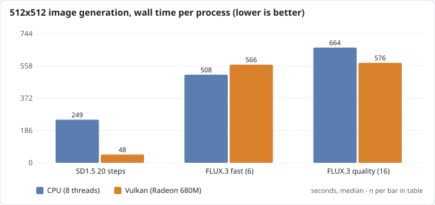
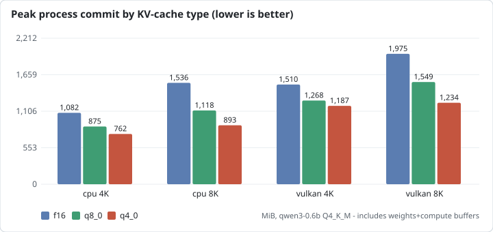
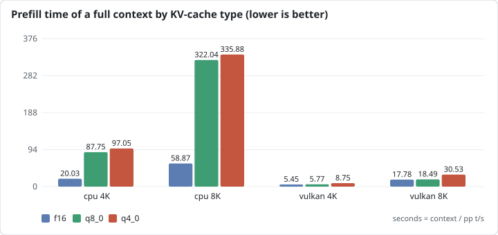

# Benchmarks

Everything here is copied or computed from the raw JSON under `docs/test-evidence/benchmarks/` (wave D, 2026-11-20); nothing is
estimated. Status words: PASS / NOT RUN / BLOCKED. Methodology decision: `decisions/ADR-010-benchmark-methodology.md`.
All numbers come from **one machine** and must not be generalised to other hardware, models, quantisations or drivers.

## Wave D: final binaries

**Binaries under test** (`environment.json`): the static EXEs of wave B (not the final shipped release binaries, see below), `windows-msvc-release-static`
(CPU, 44,229,120 bytes, SHA-256 `c3a613e6...c717`) and `windows-msvc-release-static-vulkan`
(86,548,992 bytes, SHA-256 `b94a6e06...cbe8`; full hashes in `environment.json`). The EXEs embed the build commit
`cca2c6896c58+dirty` (shown in every `text-full-*.json`); the repository HEAD when the runs started was `5b3214d`
(only SBOM/release metadata changed in between, no engine source). The llama.cpp (`d3c3e24`) and stable-diffusion.cpp
(`532d2c1`) pins are unchanged.

**Machine:** Windows 11 build 10.0.26200.9974, Ryzen 7 7735HS (8C/16T, AVX2/FMA3, no AVX-512), Radeon 680M (UMA reservation
4.27 GB, Vulkan API 1.4.315, AMD proprietary driver 26.6.1 / registry 32.0.21043.12001), 21,245,952,000 bytes RAM
(6.8-7.0 GiB free at start; ~3 GiB free during the FLUX runs), no battery (AC powered), Windows power plan
"Balanced" (not changed), no CPU temperature or clock sensor available, so **thermal state was not measured**.
Background services (a local LLM gateway and tool servers) were idle; no other heavy job ran at the same time. The
repeated runs were executed strictly one after another.

**Model drive:** the models are on a USB 3 bridge disk (`IB-1232CL-U3`, NTFS, `bus_type usb`; the rotational flag is
`unknown` to Windows). Cold sequential reads measured 38-63 MiB/s (table below), which is consistent with a
mechanical drive, but that is an inference, not a detection. The qwen3-0.6b file is on a second disk of the same
model (`E:`).

### Method

* **Text:** `HCSInfer benchmark --suite full --backend cpu|vulkan --iterations 5 --warmup 1 --max-tokens 64 --sweep-sizes 128,512,2048 --ctx 4096`
  (greedy, seed 42, one fixed prompt; 223 prompt tokens for LFM3, 199 for qwen3). Medians and p90 of the 5 measured
  iterations; the raw samples are inside each JSON (AGENTS.md 21.1, `schema_version 1`, full machine/build/model metadata,
  model SHA-256). Prompt throughput is reported here as **prompt tokens / TTFT**, because the Vulkan engine field is
  inflated by asynchronous submission (known caveat, see below).
* **Upstream cross-check:** `llama-bench -p 512 -n 128 -r 5` (`-t 8` CPU, `-ngl 99` Vulkan) from the same pinned llama.cpp.
* **KV cache:** the HCS engine does not expose cache types, so this uses `llama-bench -p <ctx> -n 0 -fa 1 -ctk X -ctv X`
  (K and V the same type, flash attention on, which quantised V cache requires). "TTFT proxy" = ctx / pp t/s, i.e. the
  time to prefill a full context. Memory is the peak working set / peak commit of the `llama-bench` process sampled
  every 200 ms (`GetProcessMemoryInfo`) and includes weights and compute buffers. Repetitions: 5 per row, except the
  CPU rows with quantised cache at 8192 (2 repetitions each, because one repetition took ~8 minutes).
* **Vision:** `HCSInfer vision --json` with LFM3-Omni-2B Q8_0 + its mmproj on a deterministic 512x512 synthetic PNG
  (generated by `tools/bench/bench_common.py`, SHA-256 in the JSON), 48 new tokens, temperature 0; 5 separate processes
  per backend, so each run includes its own model load.
* **Image:** `HCSInfer image generate`, 512x512, seed 42. SD1.5 Q8_0 uses 20 steps; FLUX.3 Klein UD-Q4_K_XL uses the
  `fast` (6 steps) and `quality` (16 steps) presets with the Qwen3-VL-4B Q4_K_M encoder and FLUX.2 VAE. The number is the
  wall time of the whole process (model load + text encode + sampling + VAE + PNG). **N is stated in every row**: SD1.5
  5 (Vulkan) / 2 (CPU); FLUX 1 per cell - those are single samples, not medians, and are provisional.
* **API:** `HCSInfer serve` on loopback with a bearer token; a Python client measures request-sent -> first non-empty
  content delta of a streaming `/v1/chat/completions` (10 measured requests after 1 discarded), plus non-streaming
  latency and the first request that also loads the model. The API prompt is ~20 tokens, so its TTFT is **not
  comparable** with the ~223-token TTFT of the engine benchmark.
* **Drive:** `HCSInfer doctor --read-file` (read-only, 4 MiB buffer, up to 1 GiB per sample).
* **Cold vs warm:** "cold" is *process-cold*; the OS file cache is never flushed (needs administrator rights) and the
  driver shader cache is not controlled. Because each model was benchmarked CPU first and Vulkan second, the Vulkan
  "cold load" figures read a file that the CPU run had just cached; **only the CPU cold load (and the first vision
  run) reflect a real read from the drive**. Cold and warm numbers are never compared with each other, and different
  models or quantisations are never compared as a backend comparison.
* **Memory columns:** peak working set (WS) and peak commit. On Vulkan most weights live in UMA allocations that count as
  commit, not working set, so a low Vulkan WS is not a memory saving.

### Charts (generated from the JSON by `tools/bench/make_report.py`)








### What the numbers say (and do not say)

* **Text on Vulkan vs CPU** (same model, same quantisation): decode 1.97x (qwen3-0.6b, 60.7 -> 119.4 t/s) and 1.90x
  (LFM3-Omni-2B, 18.1 -> 34.5 t/s). Prefill is where the iGPU helps most: LFM3 TTFT 3,070 -> 393 ms (7.8x) and 2,077-token
  prefill 27.8 s -> 3.4 s. `llama-bench` agrees within noise (LFM3 tg128 18.7 -> 39.2 t/s, pp512 73.9 -> 654.6 t/s).
  The HCS adapter's decode is about 12% below `llama-bench` on Vulkan (34.5 vs 39.2 t/s) and about 3% below on CPU - not investigated.
* **Prefill at longer prompts slows down on both backends** (qwen3 Vulkan 1,375 -> 1,032 t/s from 151 to 2,071 tokens;
  decode at a 2K prompt is 87.8 vs 117.5 t/s at 151 tokens).
* **Vision:** the image encode + prefill TTFT is 5.9 s on CPU and 0.81 s on Vulkan (7.3x). The CPU load p90 of 18.7 s is
  the one run that really read the model from the USB drive.
* **SD1.5:** Vulkan is 5.2x faster than CPU (47.6 s vs 248.7 s, n=5 / n=2).
* **FLUX.3 Klein does not benefit from Vulkan on this machine** in these runs: fast 508 s (CPU) vs 566 s (Vulkan);
  quality 664 s vs 576 s. On Vulkan `fast` and `quality` differ by only 10 s (566 vs 576) although they differ by 10
  sampling steps, i.e. ~1 s per step and a fixed ~560 s per process (encoder + weights streaming from the USB drive
  into ~10 GiB of commit with only ~3 GiB RAM free). The CPU path costs ~15.6 s per extra step with a fixed ~415 s.
  Wave F measured 364-471 s on Vulkan with more free RAM; the difference is **not explained** (memory pressure is a
  hypothesis, not tested). Treat every FLUX number as a single provisional sample.
* **KV cache:** on **CPU** quantised KV with flash attention is dramatically slower (4.4x at 4K, 5.5x at 8K prefill
  versus f16) while saving only 20-40% memory - f16 is the right CPU default. On **Vulkan** q8_0 costs ~4-6% prefill
  time and saves 16-22% commit (1,975 -> 1,549 MiB at 8K); q4_0 saves 38% but costs 1.6-1.7x prefill time. Output quality of
  quantised caches was **not evaluated** (NOT RUN). The commit saving is for a 0.6B model (small KV); larger models save more
  in absolute terms.
* **HTTP API:** streaming TTFT 100 ms (Vulkan) / 318 ms (CPU) for a ~20-token prompt; the first request that also loads a cached
  model costs 2.3 s / 1.6 s.

### Not measured / limits

* Thermals, clocks and power draw: NOT RUN (no sensor access). Perf variance between sessions of up to ~10% has been seen
  in this project, so differences under that are not claims.
* Cold start from a flushed file cache: NOT RUN (needs administrator rights); see the cold/warm note.
* LPIPS / image quality of the CPU vs Vulkan renders, and quality of quantised KV caches: NOT RUN.
* FLUX.3 with N>1, CPU FLUX at other sizes, SD1.5 CPU with N=5: NOT RUN (time).
* B2, B3, B4, B5, B6, B8 of AGENTS.md 16.6: unchanged (see the earlier sections below).
* Hardware-flagged: the drive's media type could not be detected, so no "HDD" claim is made beyond the measured MiB/s.

### Regression thresholds

`tools/bench/regression-thresholds.json` defines the >5% median-regression alert (10% for load times and API TTFT, whose run-to-run
noise is higher). `docs/test-evidence/benchmarks/summary.json` is the flat baseline produced from these runs;
`python tools/bench/check_regression.py <baseline summary.json> <candidate summary.json>` exits 1 on an alert. It is an
alert, not a hard failure, and needs the same model hash, backend, build and driver.

### Reproduce

```powershell
# set HCS_EXE_CPU, HCS_EXE_VK, HCS_LLAMA_BENCH_CPU, HCS_LLAMA_BENCH_VK, HCS_MODELS, HCS_QWEN3 (see the header of tools/bench/run_matrix.py)
python tools/bench/run_matrix.py env --out docs/test-evidence/benchmarks
python tools/bench/run_matrix.py text --iterations 5 --out docs/test-evidence/benchmarks     # then: llamabench kv vision api sd flux hdd
python tools/bench/make_report.py --data docs/test-evidence/benchmarks --charts docs/benchmarks --tables tables.md --readme-table readme-table.md
```

### Result tables

### Text: `HCSInfer benchmark --suite full` (warm medians over 5 measured iterations, 1 warm-up discarded)

| Model | Backend | status | cold load | cold TTFT | warm load med / p90 | warm TTFT med / p90 | prompt tokens / TTFT (t/s) | decode t/s med / p90 | peak WS / commit |
|---|---|---|---|---|---|---|---|---|---|
| qwen3-0.6b Q4_K_M | CPU (8 threads) | PASS | 7,650 ms | 461 ms | 549 / 596 ms | 444 / 475 ms | 448.2 | 60.73 / 61.04 | 1,126 MiB / 1,101 MiB |
| qwen3-0.6b Q4_K_M | Vulkan (Radeon 680M) | PASS | 709 ms | 887 ms | 470 / 475 ms | 156 / 158 ms | 1,273.9 | 119.41 / 120.24 | 372 MiB / 1,563 MiB |
| LFM3-Omni-2B Q8_0 | CPU (8 threads) | PASS | 12,312 ms | 3,072 ms | 415 / 525 ms | 3,070 / 3,135 ms | 72.6 | 18.12 / 18.27 | 1,995 MiB / 509 MiB |
| LFM3-Omni-2B Q8_0 | Vulkan (Radeon 680M) | PASS | 1,201 ms | 384 ms | 1,116 / 1,148 ms | 393 / 478 ms | 567.8 | 34.52 / 35.64 | 496 MiB / 2,669 MiB |

### Prefill sweep: TTFT and prompt throughput (1 new token; median / p90 of 5)

| Model | Backend | prompt tokens | TTFT ms (med / p90) | prompt tokens / TTFT (t/s) | decode t/s at that prompt size (med) |
|---|---|---|---|---|---|
| qwen3-0.6b Q4_K_M | CPU (8 threads) | 151 | 336 / 343 | 449.1 | 62.21 |
| qwen3-0.6b Q4_K_M | CPU (8 threads) | 535 | 1,224 / 1,234 | 437.1 | 49.77 |
| qwen3-0.6b Q4_K_M | CPU (8 threads) | 2071 | 6,395 / 6,474 | 323.8 | 24.93 |
| qwen3-0.6b Q4_K_M | Vulkan (Radeon 680M) | 151 | 110 / 111 | 1,374.9 | 117.48 |
| qwen3-0.6b Q4_K_M | Vulkan (Radeon 680M) | 535 | 374 / 380 | 1,431.5 | 104.72 |
| qwen3-0.6b Q4_K_M | Vulkan (Radeon 680M) | 2071 | 2,007 / 2,026 | 1,032.1 | 87.82 |
| LFM3-Omni-2B Q8_0 | CPU (8 threads) | 151 | 2,044 / 2,099 | 73.9 | 18.27 |
| LFM3-Omni-2B Q8_0 | CPU (8 threads) | 529 | 7,082 / 7,118 | 74.7 | 18.01 |
| LFM3-Omni-2B Q8_0 | CPU (8 threads) | 2077 | 27,762 / 27,992 | 74.8 | 17.01 |
| LFM3-Omni-2B Q8_0 | Vulkan (Radeon 680M) | 151 | 275 / 277 | 548.7 | 36.17 |
| LFM3-Omni-2B Q8_0 | Vulkan (Radeon 680M) | 529 | 863 / 1,017 | 613.0 | 35.77 |
| LFM3-Omni-2B Q8_0 | Vulkan (Radeon 680M) | 2077 | 3,409 / 4,061 | 609.2 | 34.99 |

### Cross-check with upstream `llama-bench` (pp512 / tg128, 5 repetitions; same pinned llama.cpp)

| Model | Backend | pp512 t/s (mean ± sd) | tg128 t/s (mean ± sd) | peak WS / commit |
|---|---|---|---|---|
| qwen3-0.6b Q4_K_M | CPU (8 threads) | 413.7 ± 5.8 | 70.0 ± 0.9 | 736 MiB / 682 MiB |
| qwen3-0.6b Q4_K_M | Vulkan (Radeon 680M) | 1,511.5 ± 28.4 | 141.6 ± 5.2 | 254 MiB / 1,023 MiB |
| LFM3-Omni-2B Q8_0 | CPU (8 threads) | 73.9 ± 0.6 | 18.7 ± 0.0 | 1,906 MiB / 406 MiB |
| LFM3-Omni-2B Q8_0 | Vulkan (Radeon 680M) | 654.6 ± 5.2 | 39.2 ± 0.1 | 456 MiB / 2,524 MiB |

### Vision: LFM3-Omni-2B Q8_0 + mmproj, 512x512 test image, 48 max new tokens (separate process per run)

| Backend | n ok / n | load ms (med / p90) | TTFT incl. image encode ms (med / p90) | decode t/s (med) | wall s (med) | peak WS / commit |
|---|---|---|---|---|---|---|
| CPU (8 threads) | 5 / 5 | 1,099 / 18,719 | 5,898 / 6,024 | 17.3 | 9.6 | 2,544 MiB / 2,114 MiB |
| Vulkan (Radeon 680M) | 5 / 5 | 2,006 / 2,447 | 810 / 1,271 | 34.0 | 4.0 | 1,096 MiB / 4,523 MiB |

### Image generation, 512x512, seed 42, wall time of a whole `image generate` process (load + sampling + VAE + PNG)

| Model | Setting | Backend | n ok / n | wall s median (p90) | all samples (s) | peak WS / commit |
|---|---|---|---|---|---|---|
| SD1.5 Q8_0 | 20 steps | CPU (8 threads) | 2 / 2 | 248.7 (249.4) | 249.4, 248.0 | 3,341 MiB / 3,649 MiB |
| SD1.5 Q8_0 | 20 steps | Vulkan (Radeon 680M) | 5 / 5 | 47.6 (51.1) | 51.1, 47.5, 47.1, 48.1, 47.6 | 1,947 MiB / 4,601 MiB |
| FLUX.3 Klein UD-Q4_K_XL | preset fast (6 steps) | CPU (8 threads) | 1 / 1 | 508.0 (508.0) | 508.0 | 7,445 MiB / 7,658 MiB |
| FLUX.3 Klein UD-Q4_K_XL | preset fast (6 steps) | Vulkan (Radeon 680M) | 1 / 1 | 566.2 (566.2) | 566.2 | 6,366 MiB / 9,911 MiB |
| FLUX.3 Klein UD-Q4_K_XL | preset quality (16 steps) | CPU (8 threads) | 1 / 1 | 664.4 (664.4) | 664.4 | 7,444 MiB / 7,658 MiB |
| FLUX.3 Klein UD-Q4_K_XL | preset quality (16 steps) | Vulkan (Radeon 680M) | 1 / 1 | 576.5 (576.5) | 576.5 | 6,308 MiB / 9,899 MiB |

### KV cache type x context (upstream `llama-bench`, qwen3-0.6b Q4_K_M, flash attention on, K and V same type, pp = whole context; repetitions per row in the status column)

| Backend | context | cache | pp t/s (mean ± sd) | TTFT proxy s (= ctx / pp) | peak WS MiB | peak commit MiB | status |
|---|---|---|---|---|---|---|---|
| CPU (8 threads) | 4096 | f16 | 204.4 ± 25.0 | 20.03 | 1,142 | 1,082 | PASS, n=5 |
| CPU (8 threads) | 4096 | q8_0 | 46.7 ± 0.8 | 87.75 | 935 | 875 | PASS, n=5 |
| CPU (8 threads) | 4096 | q4_0 | 42.2 ± 3.7 | 97.05 | 823 | 762 | PASS, n=5 |
| CPU (8 threads) | 8192 | f16 | 139.2 ± 0.5 | 58.87 | 1,595 | 1,536 | PASS, n=5 |
| CPU (8 threads) | 8192 | q8_0 | 25.4 ± 0.0 | 322.04 | 1,175 | 1,118 | PASS, n=2 |
| CPU (8 threads) | 8192 | q4_0 | 24.4 ± 0.0 | 335.88 | 951 | 893 | PASS, n=2 |
| Vulkan (Radeon 680M) | 4096 | f16 | 751.5 ± 6.8 | 5.45 | 345 | 1,510 | PASS, n=5 |
| Vulkan (Radeon 680M) | 4096 | q8_0 | 709.8 ± 3.3 | 5.77 | 516 | 1,268 | PASS, n=5 |
| Vulkan (Radeon 680M) | 4096 | q4_0 | 468.1 ± 3.7 | 8.75 | 352 | 1,187 | PASS, n=5 |
| Vulkan (Radeon 680M) | 8192 | f16 | 460.8 ± 2.1 | 17.78 | 263 | 1,975 | PASS, n=5 |
| Vulkan (Radeon 680M) | 8192 | q8_0 | 443.1 ± 1.8 | 18.49 | 263 | 1,549 | PASS, n=5 |
| Vulkan (Radeon 680M) | 8192 | q4_0 | 268.4 ± 0.3 | 30.53 | 515 | 1,234 | PASS, n=5 |

### HTTP API latency (`HCSInfer serve`, loopback, LFM3-Omni-2B Q8_0, 10 measured requests after 1 discarded)

| Backend | first request incl. model load | stream TTFT ms (med / p90) | stream total ms (med) | non-stream total ms (med / p90) | server peak WS / commit |
|---|---|---|---|---|---|
| CPU (8 threads) | 1,635 ms | 318 / 335 | 1,031 | 1,024 / 1,034 | 2,430 MiB / 2,094 MiB |
| Vulkan (Radeon 680M) | 2,255 ms | 100 / 105 | 461 | 476 / 490 | 1,100 MiB / 4,473 MiB |

### Model drive: sequential read, read-only (`HCSInfer doctor --read-file`, 4 MiB buffer, up to 1 GiB per sample)

| File | phase | MiB/s (median) | samples |
|---|---|---|---|
| `LFM3-Omni-2B-Q8_0.gguf` | first-read (likely cold) | 37.6 | 1 |
| `Qwen3VL-4B-Instruct-Q4_K_M.gguf` | first-read (likely cold) | 55.9 | 1 |
| `SmolVLM2-500M-Video-Instruct-Q8_0.gguf` | first-read (likely cold) | 63.3 | 1 |
| `LFM3-Omni-2B-Q8_0.gguf` | repeat (page-cache warm) | 6,162.1 | 3 |

## Earlier measurements (before wave D, kept for history)

The sections below predate wave D, were measured on earlier builds or with fewer repetitions, and are superseded by the tables above where they overlap.

## B0 / B1: qwen3-0.6b Q4_K_M, CPU vs Vulkan

Source: `test-evidence/benchmark/README.md` and its JSON files. Git `fddc30df1218` (clean tree), both builds Release.
Model `qwen3-0.6b-q4_k_m.gguf`, 484,219,712 bytes, SHA-256
`4ea794120a3b2244a6e8a36354f1aa53e7f0c52b2f1f280dde0d7f522f37ae7c`, read from the external USB (NTFS) drive.
Identical parameters: context 4096, max-new-tokens 64, temperature 0, seed 42, 1 warm-up, 3 measured iterations,
one fixed 199-token prompt.

| Metric | B0 CPU | B1 Vulkan (Radeon 680M) |
|---|---|---|
| backend / device | `CPU` | `Vulkan`, `AMD Radeon(TM) Graphics (Vulkan0)`; API 1.4.315, driver `26.6.1` |
| cold model load | 502 ms | 546 ms |
| cold TTFT | 362 ms | 138 ms |
| cold decode | 66.7 tokens/s | 128.5 tokens/s |
| warm model load (median / p90) | 503 / 505 ms | 390 / 393 ms |
| warm TTFT (median / p90) | 369 / 387 ms | 134 / 142 ms |
| warm prompt processing (median / p90) | 558 / 577 tokens/s | 17,461 / 24,612 tokens/s (see caveat) |
| warm decode (median / p90) | 66.10 / 66.25 tokens/s | 126.14 / 126.50 tokens/s |
| peak process working set / commit | 1,159,835,648 B / 1,149,767,680 B | 304,033,792 B / 1,545,367,552 B |

Caveats from the same file: the very first Vulkan run on an empty driver shader cache recorded cold TTFT 2,810 ms, so a
cold Vulkan figure from an uncontrolled cache state must not be quoted as steady state. The lower Vulkan working set is
mostly UMA allocations that show up as commit, not a real memory saving. The Vulkan prompt-throughput field is
inconsistent with TTFT (asynchronous submission), so use TTFT for Vulkan prefill. `hdd_read_mib_s_median` is `unknown`
and `decompression_mib_s_median` is `not_applicable` because the Model Vault is not in the engine load path.

## LFM3-Omni-2B Q8_0 quick benchmark

Source: `test-evidence/lfm3/README.md` (the `-quiet` runs, one controlled run each; the other three files were recorded
while other processes were compiling and are kept for honesty). Same parameters as B0/B1 except a 223-token prompt.
Model `LFM3-Omni-2B-Q8_0.gguf`, 1,846,240,768 bytes on disk (verified with `Get-Item`; `llama-bench` prints 1,837,991,168 in `model_size` because it reports the in-memory tensor bytes, 8,249,600 fewer), SHA-256
`59118f661eaacb93d204723d76355b53347f0940b508c11412f6290fd49158d4`.

| Metric (warm medians) | CPU, 8 threads | Vulkan (Radeon 680M) |
|---|---|---|
| decode tokens/s | 18.8 (p90 18.9) | 35.9 (p90 37.5) |
| TTFT | 2,790 ms | 438 ms |
| model load (warm) | 391 ms | 982 ms |
| peak process working set / commit | 2,057 MB / 528 MB | 514 MB / 2,790 MB |

## LFM3-Omni-2B Q8_0 full-suite benchmark (`--suite full`)

Source: `test-evidence/benchmark/full-suite-real.json`. Same model as above, CPU, context 4096, `--sweep-sizes
32,128,256`, 0 warm-up, 1 measured iteration per point (a smoke run, not a baseline), seed 42. `result_status` PASS.

| point | target tokens | real prompt tokens | TTFT ms | prompt tokens/s | decode tokens/s |
|---|---|---|---|---|---|
| prefill | 32 | 43 | 558 | 77.5 | - |
| prefill | 128 | 151 | 1369 | 110.6 | - |
| prefill | 256 | 277 | 2639 | 105.1 | - |
| decode | 32 | 43 | - | - | 19.49 |
| decode | 128 | 151 | - | - | 19.22 |
| decode | 256 | 277 | - | - | 19.19 |

The first run of this suite (before the W1 fix D-S6) recorded every prefill point as FAIL; the benchmark treated a
1-token generation's "0 decoded tokens" (the adapter counts `sampled - 1`) as an error.

## Load modes (M5 Stage A, CPU)

Source: `test-evidence/M5-loadmodes/README.md`. Same model and parameters as B0, `--no-hash`, build `build/img-api`
(Release, CPU-only), model read from the external USB drive. One run per mode, 3 measured iterations.

| mode | cold load ms | warm load median ms | warm decode t/s | peak working set MB | peak commit MB |
|---|---|---|---|---|---|
| `auto` | 630 | 664 | 60.8 | 1106 | 1096 |
| `mmap` | 674 | 651 | 60.2 | 1106 | 1096 |
| `none` | 768 | 655 | 59.7 | 984 | 1347 |
| `mlock` | 759 | 836 | 59.8 | 984 | 1347 |
| `mmap+mlock` | 900 | 871 | 59.3 | 1170 | 1097 |
| `direct_io` | 9538 | 9092 | 58.8 | 985 | 1348 |

Only the `direct_io` load-time effect (it bypasses the file cache; about 14x here) is large enough to survive the
uncontrolled cache state. Decode throughput does not differ because the model fits in RAM. A storage-bound comparison
(model larger than RAM, controlled cache) is BLOCKED on this machine.

## B7: stable-diffusion.cpp compute backend vs parameter backend

Source: `test-evidence/B7-params/README.md` and `b7-summary.json`. `sd-cli` of stable-diffusion.cpp `master-1106-532d2c1`
(pin `532d2c15c430a785a712b2d94281f04e733008a4`, patched GGML build), model SD1.5 Q8_0 (1,763,578,176 bytes) on the
internal `D:` drive, 256x256, 2 steps, seed 42, **one sample per configuration** (not medians).

| compute backend | params backend | wall ms | peak working set MB | peak commit MB |
|---|---|---|---|---|
| `vulkan0` | `cpu` | 5218 | 1772.8 | 3572.3 |
| `vulkan0` | `disk` | 3288 | 624.8 | 2255.0 |
| `cpu` | `cpu` | 9676 | 2219.5 | 2410.0 |

The output PNGs of the three runs differ byte-wise; equivalence is not verified. Disk parameter placement was faster
here only because the model sat on fast local storage and in the file cache; a USB-HDD run is NOT RUN, and the
ranking would very likely invert there.

## M8 HCS kernel runtime (isolated, feature-flagged)

`hcs_kernel_bench` (`test-evidence/vulkan-kernels/`) measures the single HCS Q8_0 GEMV kernel against its CPU
reference, **not inside a model**. Radeon 680M, CPU reference single-threaded, 20 timed calls after warm-up.

| m x k | CPU (ms) | Vulkan (ms) | CPU/Vulkan | max abs err | Vulkan GiB/s |
|---|---|---|---|---|---|
| 512x512 | 0.171 | 1.313 | 0.1x | 4.8e-06 | 0.20 |
| 1024x1024 | 0.679 | 1.408 | 0.5x | 1.1e-05 | 0.74 |
| 2048x2048 | 2.761 | 1.910 | 1.4x | 1.9e-05 | 2.17 |
| 4096x4096 | 11.11 | 4.558 | 2.4x | 3.5e-05 | 3.64 |
| 4096x11008 | 30.01 | 12.01 | 2.5x | 8.4e-05 | 3.71 |
| 11008x4096 | 30.00 | 14.31 | 2.1x | 3.8e-05 | 3.12 |

Small shapes lose to per-call buffer/dispatch overhead; large shapes win by ~2.1-2.5x at ~3.6 GiB/s. The kernel is
feature-flagged **OFF**. Wave K measured the upstream baseline (below), so it is not default-enabled
(`docs/vulkan-kernels.md`, AGENTS.md 16.6 B3).

**Wave K upstream baseline (2026-11-20, llama.cpp `d3c3e24`, 5 repetitions, median/p90, `test-evidence/vulkan-kernels/m8-baseline/`):** GGML Vulkan `MUL_MAT` q8_0 m=4096 n=1 k=14336 = 0.822 ms (70.7 GiB/s, resident weights) vs the HCS kernel at the same shape 14.99 ms per call (3.88 GiB/s) = 18.2x slower. `llama-bench` tg128 on Vulkan: qwen3-0.6b Q4_K_M 148.1 / p90 150.1 t/s (CPU 75.1), LFM3-Omni-2B Q8_0 39.7 / 39.8 t/s (CPU 19.3). Cold (process-cold, file cache not flushed) and warm are separate files.

A second variant (v2, shared-memory tiling of the activation vector) was measured against v1 (`--reps 30`,
`test-evidence/vulkan-kernels/gemv-q8_0-variants-bench.json`): **no benefit** (within noise on every shape), so the
hypothesis was rejected and v1 stays the default (`docs/research/vulkan-gemv-v2-shared-memory.md`).

## Upstream GGML Vulkan operators, in-process (wave C / k1, 2026-11-26)

`hcs_ggml_vk_bench --suite llm` (`tools/ggml-vk-bench`, label `performance`) drives the pinned ggml Vulkan backend
(llama.cpp `d3c3e24`, the engines' GGML) directly: a one-node graph per operation, inputs device resident, 10+
warm-up runs until 250 ms, **15 timed samples** of `ggml_backend_graph_compute` (submit + wait), median / p90 /
spread = (p90 - p10) / median, every result spot-checked against a double-precision reference. AMD Radeon 680M
(`AMD Radeon(TM) Graphics`, driver 26.6.1, Vulkan 1.4.315, subgroup 64), Release, source commit `1469638` (+ the
uncommitted k1 work), one run, warm, no model files involved (synthetic data). Raw: `test-evidence/wave-c/k1/
ggml-vk-bench-llm.json` (AGENTS.md 21.1 fields) and `.txt`. A floor of ~0.07 ms per submit is included in every row
(see RoPE 1x128). Rows with spread > 0.25 are not conclusive.

```
op         w     shape (m,n,k)       median ms   p90 ms  spread  GFLOP/s  variant / note
mul_mat    f32   1,4096,4096            0.9387   0.9656   0.058     35.7  decode GEMV, f32 weights
mul_mat    f16   1,4096,4096            0.5176   0.5214   0.034     64.8
mul_mat    q8_0  1,4096,4096            0.3223   0.3583   0.159    104.1  q8_0 weights x f32 activations
mul_mat    q4_k  1,4096,4096            0.2384   0.3006   0.374    140.7  (spread > 0.25)
mul_mat    q8_0  1,14336,4096           0.9904   1.1309   0.193    118.6
mul_mat    q4_k  1,14336,4096           0.5189   0.5287   0.048    226.3
mul_mat    f16   128,4096,4096          2.7986   2.8736   0.083   1534.7  prefill
mul_mat    q8_0  128,4096,4096          2.5945   2.7721   0.105   1655.4
mul_mat    f32   512,4096,4096         14.0311  14.4824   0.063   1224.4
mul_mat    f16   512,4096,4096         10.3010  10.9919   0.124   1667.8
mul_mat    q8_0  512,4096,4096          9.9295  10.4395   0.095   1730.2
mul_mat    f32   4096,320,320           0.5060   0.5855   0.212   1657.8  SD 1x1 conv / attention projection
mul_mat    f32   1024,320,2880         1.2939   1.3144   0.027   1458.7  SD 3x3 conv as GEMM, 32x32 latent
softmax    f32   1024,1024,0            0.2464   0.2816   0.209     25.5
rmsnorm    f32   512,4096,0            0.3481   0.3642   0.089     24.1  rms_norm + mul
layernorm  f32   4096,320,0            0.8088   0.8331   0.052     13.0  norm + mul + add (3 ops)
rope       f32   4096,128,0            0.1432   0.1654   0.160     11.0  NEOX
```

One upstream operator failed its own spot check: F32 `mul_mat` 1024x1024x64 (error 1.01e-4 against a 1.0e-4 scale-free
bound, likely reduced-precision accumulation in the backend); it is recorded as `error` and the F16 variant is used.

`HCSInfer tune --suite llm` puts the HCS kernels next to these numbers (one complete run: `test-evidence/wave-c/k1/
single-run-table.md`): the HCS GEMM kernels are 2x-5x slower than upstream on the real shapes, softmax / RMSNorm / RoPE
are at parity, LayerNorm is faster in 4 of 5 buckets in that single run (fused vs upstream's 3-op chain) but is not
promoted (the rule needs 3 runs and half of those buckets have an upstream spread > 0.25). Repeat runs were BLOCKED
(see `docs/vulkan-kernels.md`). Nothing is default-enabled.

## Earlier provisional numbers

`test-evidence/M1/llama/` (llama-bench, uncontrolled, few samples; for example qwen3 0.6B Q4_K CPU pp128 416.65 t/s,
tg64 67.89 t/s at build `d3c3e24`) and `test-evidence/M6-storage/` are not comparable with the controlled runs above.

## Re-check on the shipped release binaries (audit fix)

The tables above were measured on the wave-B static EXEs (embedded commit `cca2c68+dirty`). The release files were rebuilt
afterwards from clean commit `ae3bbbd` (CPU `HCSInfer.exe` SHA-256 `d9b1a6bd...`; Vulkan `a77cf42a...`; full hashes in `release-final/SHA256SUMS-final.txt`). To avoid claiming numbers for binaries that were not measured, a short quick benchmark and an
empty-PATH run were repeated on the **shipped** files (`docs/test-evidence/release-final/shipped-binaries/`; LFM3-Omni-2B Q8_0,
context 4096, 64 new tokens, 1 warm-up + 3 measured iterations, warm):

| Backend | decode t/s, wave D (5 it) | decode t/s, shipped (3 it) | warm TTFT ms, wave D | warm TTFT ms, shipped |
|---|---|---|---|---|
| CPU | 18.1 | 18.2 | 3,070 | 2,989 |
| Vulkan (Radeon 680M) | 34.5 | 34.4 | 393 | 382 |

Agreement is within 3% (a 3-iteration quick run, not a replacement for the 5-iteration full suite). The empty-PATH runs of both
shipped EXEs passed (`--help`, `doctor --json`, a real generation - CPU, and the Radeon 680M for the Vulkan EXE - `serve` health 200,
GUI page 200, all loaded modules under the Windows directory). The wave-D prefill sweeps, vision, image and KV tables were not repeated
on the shipped files (NOT RUN).

## Wave B: static builds (2026-11-20)

Model LFM3-Omni-2B Q8_0 (`LFM3-Omni-2B-Q8_0.gguf`), `HCSInfer benchmark --suite quick --iterations 5 --max-tokens 64`,
same machine (Ryzen 7 7735HS, Radeon 680M, other work idle), one run per variant, median / p90. Raw JSON:
`docs/test-evidence/wave-b/bench-*.json`. Single runs: differences of a few percent are within the noise this project
has seen between sessions; they are **not** a controlled A/B.

| Build | Backend | decode t/s median (p90) | prompt t/s median | TTFT ms median |
|---|---|---|---|---|
| `windows-msvc-release` (/MD, OpenMP ON) | CPU | 18.96 (18.99) | 77.7 | 2874 |
| `windows-msvc-release-static` (/MT, OpenMP OFF) | CPU | 18.59 (18.72) | 74.3 | 3006 |
| `windows-msvc-release-static-vulkan` (/MT) | Vulkan | 35.64 (37.35) | see note | 381 |

Static CPU vs OpenMP CPU: -1.9% decode, -4.4% prefill (under the 5% regression alert threshold of AGENTS.md 16.6, one run).
The Vulkan row is lower than the wave-K `llama-bench` figure for the same model (39.7 t/s); the tools differ and no
controlled comparison was made, so no regression or equivalence is claimed. Its prompt rate (20,711 t/s) comes from a
tiny prompt served from a warm graph and is not a meaningful prefill benchmark.
