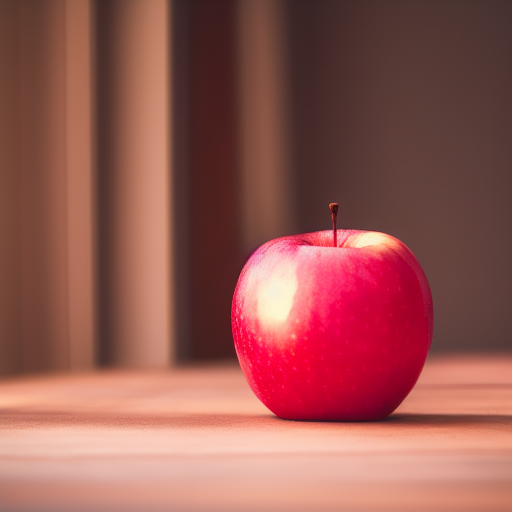
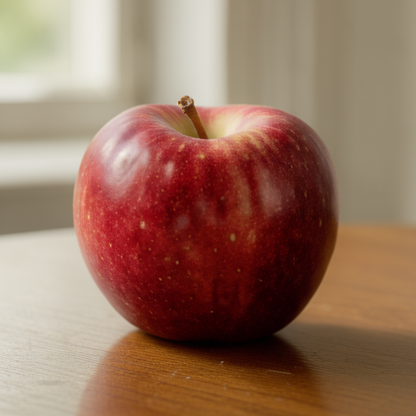
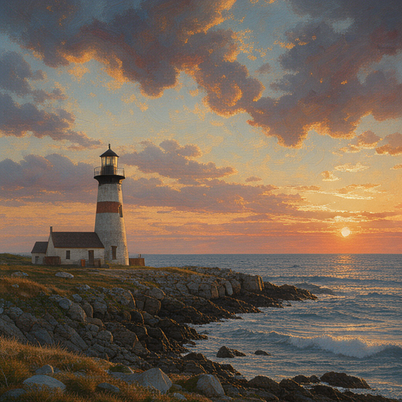
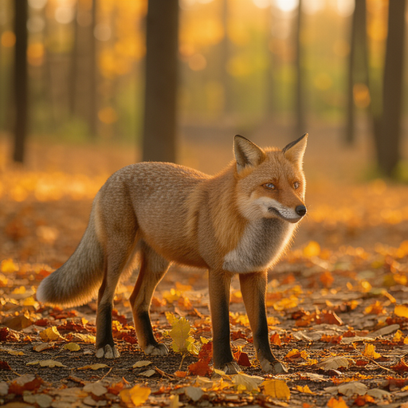

# Image gallery (real renders)

Six real text-to-image renders from the HCSInfer binary (`HCSInfer image generate`), made 2026-11-25/26 for wave A task a3.
Each image was opened and looked at; the notes below are honest, including flaws. The tiny 256x256 / 2-step PNGs in
`docs/test-evidence/` are pipeline smoke tests only, not examples of quality (see `docs/test-evidence/README.md`).

**Run conditions (all six):** backend `cpu` (explicit `--backend cpu`; the binary was built with Vulkan but these runs did
not use it), AMD Ryzen 7 7735HS, Windows 11 (26200), build `build/a3` Release at commit `8713f2a`, one run per image (no
repetitions, so times are single samples, not medians), free RAM before each run 9.8-10.9 GB (see
`docs/test-evidence/wave-a/a3/gallery/run.log`). Raw per-run JSON, stderr and the run script output are in
`docs/test-evidence/wave-a/a3/gallery/`. "Time" is `generation_ms` from the JSON result (model load excluded; load was
0.2-7 s with the model files already in the Windows file cache).

## SD 1.5 Q8_0, 512x512, 20 steps (defaults: Euler a, cfg 7)

Model `D:\HCSModels\diffusion\sd15-q8_0.gguf`, SHA-256 `D0555243938C62FAEEFB4AC93F6C7A053AD373A4290C5256BCE229AEB193BF94`.
Negative prompt for all three: `blurry, low quality, deformed, watermark, text`.

| Image | Prompt | Seed | Time | Quality note |
|---|---|---|---|---|
|  | a ripe red apple on a wooden table, soft window light, photograph, sharp focus | 1234 | 564.6 s | Clean, believable apple with shallow depth of field and warm light. Flaws: the table and background are a soft beige/pink wash, the "window light" is only a vague striped blur, the highlight on the apple is slightly blown out. |
|  | a lighthouse on a rocky coast at sunset, dramatic sky, oil painting | 42 | 304.9 s | Convincing painterly look and colour. Flaws: the lighthouse is a thin generic shape with no real lantern detail, the rocks are smooth blobs, and the sea is a flat blue band. |
|  | a cozy log cabin in a snowy pine forest at dusk, warm glowing windows, highly detailed | 7 | 309.6 s | Strong atmosphere and lighting. Flaws: the roof geometry is not architecturally consistent (the A-frame glazing sits over a second low roof), the right side of the cabin is ambiguous, and the snow on the ground is featureless. |

The first SD 1.5 run (565 s) was slower than the other two (about 305 s each); the cause was not investigated (possible
background load or cold start), so treat all times as single, indicative samples.

## FLUX.3 Klein UD-Q4_K_XL, 512x512, `--preset fast` (6 steps)

Model `D:\HCSModels\diffusion\flux3\flux-3-image-klein-UD-Q4_K_XL.gguf`, SHA-256
`0A057E07550A5B2169E344D686171A7DD3C7D82C7D8D1D1605D8D881C16E9FA7`. Text encoder `Qwen3VL-4B-Instruct-Q4_K_M.gguf`
(SHA-256 `66358CB18BB6B3B1B6675AA412C7A88EF01D228F481184D13668E5201C730A0A`), VAE `flux2-vae.safetensors` (SHA-256
`D64F3A68E1CC4F9F4E29B6E0DA38A0204FE9A49F2D4053F0EC1FA1CA02F9C4B5`), loaded through the model's `.components.json`
sidecar, parameters on the CPU. No negative prompt. Licence: FLUX Kommunity (non-commercial; see `LICENSE.md` next to the
model); model files are not part of this repository.

| Image | Prompt | Seed | Time | Quality note |
|---|---|---|---|---|
|  | a ripe red apple on a wooden table, soft window light, photograph | 1234 | 738.0 s | Best of the six: realistic skin texture, speckles, correct window bokeh and table reflection. Flaw: a slightly smudged patch on the left side of the apple. |
|  | a lighthouse on a rocky coast at sunset, dramatic sky, oil painting | 42 | 489.1 s | Rich sky, a coherent lighthouse with keeper's house, believable rocks and surf. It reads as a painterly photo rather than a strict oil painting; fine detail (windows, rail) is soft. |
|  | a red fox standing in an autumn forest, golden leaves, soft morning light, photograph | 7 | 422.0 s | Photographic fox with good fur and lighting. Flaws: the body looks long, the leg and paw placement (especially the hind legs) is not fully convincing, and the tail is dull compared with the rest of the animal. |

Notes: FLUX is 6 steps at `fast` here, measured preset from the wave-A image profile (`include/hcs/image_profiles.hpp`). The
quality of the `fast` preset against the 16-step reference has no recorded LPIPS in this task. Rendering on CPU is slow
(7-12 minutes per 512x512 FLUX image); the Vulkan path was not used for this gallery.

## Reproduce

```powershell
$exe = '.\build\windows-msvc-release\bin\HCSInfer.exe'
& $exe image generate --model D:\HCSModels\diffusion\sd15-q8_0.gguf --prompt "a ripe red apple on a wooden table, soft window light, photograph, sharp focus" `
   --negative "blurry, low quality, deformed, watermark, text" --width 512 --height 512 --steps 20 --seed 1234 --backend cpu --output apple.png --json
& $exe image generate --model D:\HCSModels\diffusion\flux3\flux-3-image-klein-UD-Q4_K_XL.gguf --prompt "a red fox standing in an autumn forest, golden leaves, soft morning light, photograph" `
   --width 512 --height 512 --preset fast --seed 7 --backend cpu --output fox.png --json
```

Output is not guaranteed to be bit-identical across backends or builds.
