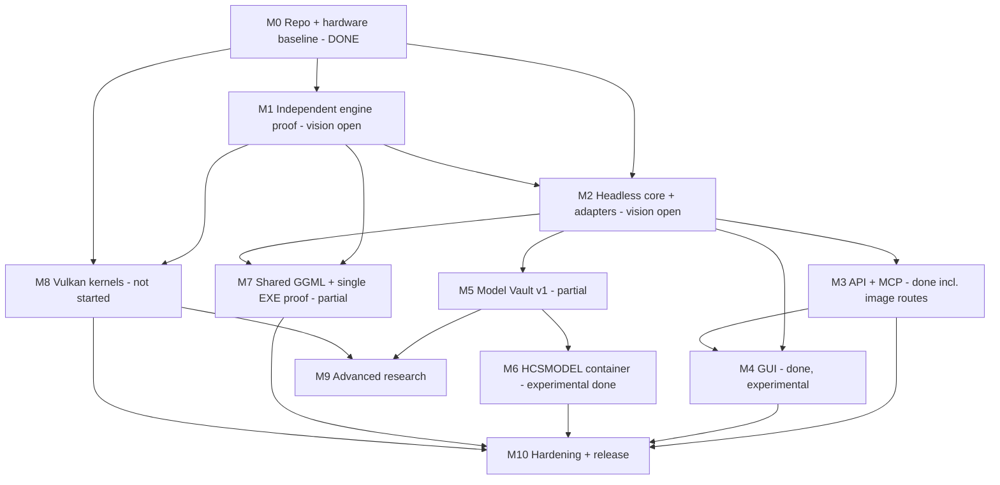

# HCSInfer implementation plan (derived from AGENTS.md section 5)

Checklist legend: `[x]` done with evidence in `docs/test-evidence/` or an inspected test, `[~]` partial,
`[ ]` open. Per-gate status and evidence live in `STATUS.md`. Updated 2026-11-18 from the inspected tree.

## Dependency graph

Critical path to V1: vision adapter -> image routes in API/MCP -> GUI (ADR-009) -> Model Vault in the load path ->
hardening/soak -> release package. M7 single-EXE and M8 kernels gate only the single-file and custom-kernel claims.
Last completed: V1-stable **W1-W3** (on `main`) plus the W1 follow-up MCP `hcs.runtime.benchmark` tool, the **W4**
static-CRT single-EXE experiment (`windows-msvc-release-static`; system-DLL-only EXE, full suite green, clean-machine
test NOT RUN - `docs/test-evidence/W4-static-exe/`, ADR-008) and the **first M8 kernel** (W5: Q8_0 GEMV,
feature-flagged OFF, CPU reference + SPIR-V validation + real-device correctness + isolated benchmark -
`docs/test-evidence/vulkan-kernels/`). Earlier: V1.1 wave 2 (`35bd39d`), wave 1 (`6a390b8`), M3 image routes + M4
embedded UI + `benchmark` command + M10 audit fixes.
Next: **W5** remainder (upstream Vulkan profiling + baseline, tuned kernel), then **W6** (release candidate); the full
wave plan is at the end of this file (the release checklist is in `STATUS.md`).

## M0 Repository and hardware baseline
- [x] Repo inspected, scaffold + build/test scripts
- [x] `src/hardware`: CPU features, RAM, OS build, GPU adapters, Vulkan device/feature/heap report
- [x] `HCSInfer doctor --json`, unknown values reported as `unknown` (`M0/doctor.json`, `doctor-no-vulkan.json`)
- [x] External drive identity + non-destructive read-speed benchmark (`M0/readbench-usb-hdd.json`)
- [x] CPU fallback with Vulkan disabled (`M0/doctor-no-vulkan.json`)
- [~] JSON schema validated: output is tested in `tests/unit/hardware`; no standalone schema file
- [x] llama.cpp / sd.cpp CPU+Vulkan build logs (`M1/`)

## M1 Independent engine proof
- [x] Pin llama.cpp + stable-diffusion.cpp commits in `external/dependency-lock.json`
- [x] llama.cpp Vulkan build, device listing, real GGUF generation from the USB drive (`M1/llama`)
- [~] Real multimodal image analysis: proven through the HCS adapter (SmolVLM2-500M Q8_0 + mmproj, CPU and Vulkan, `M2-vision/`); a standalone upstream `llama-mtmd-cli` run is NOT recorded and the model-file hashes are not in `dependency-lock.json`
- [x] sdcpp Vulkan build, diffusion smoke (SD1.5 Q8_0) (`M1/sd`)
- [x] sdcpp CPU params vs `--params-backend disk` comparison (B7) - `docs/test-evidence/B7-params/` (compute backend separate from parameter backend; disk placement uses ~1.1 GB less and was faster here, but the model is on NVMe, so the USB-HDD case is NOT RUN)
- [x] CPU-only fallback verified for text and diffusion (not for vision)
- [~] CPU/Vulkan baselines B0/B1 recorded but provisional (uncontrolled, 3-5 samples)
- [~] Unsupported model/feature behaviour: clear `Unsupported` errors exist; no documented matrix yet

## M2 Headless core
- [x] C++20 core: Result/Error + exit codes, lifecycle state machine, registry/manifest, JobQueue, MemoryBudget, Settings, PathGuard, logger, engine interfaces
- [x] CLI: `--help` everywhere, `doctor`, `models list|scan|inspect|load|unload`, `chat`, `image generate|edit`, `serve`, `mcp stdio`, `benchmark --suite quick`
- [x] Control-plane facade (`src/api/control_plane.cpp`): registry + JobQueue + engines, model switch unloads the previous model
- [~] Budget checked before eviction: `MemoryBudget` is unit-tested and fed by a live memory probe (`src/hardware/memory_probe.cpp`); verifying it against real engine loads is NOT RUN
- [x] `src/engines/llama` adapter implementing `ITextEngine` (text + vision)
- [x] `src/engines/diffusion` adapter implementing `IImageEngine` (text-to-image, img2img; CPU + Vulkan)
- [~] CLI `models load|unload`, `tune` (exit code 10 today; `cache stats|clear` is implemented; `benchmark --suite quick` and `train` are implemented; load/unload work over HTTP and MCP)
- [x] Cancellation mid-generation and 10x load/unload on the llama adapter (`M2/llama-engine-integration.txt`); [x] the diffusion adapter has blocking/cancellation integration tests (`DiffusionBlocking.*`)
- [~] ADR-001..004: finalised with the evidence available; open items are listed inside each ADR

## M3 Unified API and MCP
- [x] HTTP: `/v1/models`, `/v1/chat/completions` (+streaming), `/hcs/v1/{health,runtime,devices,memory,models,models/{id},jobs}`
- [x] `/v1/images/generations`, `/v1/images/edits` (real render, `M3-image/` 47/47)
- [x] `POST /hcs/v1/benchmarks` (job, contract-tested; real-model run NOT RUN). [x] MCP `hcs.runtime.benchmark` tool (contract-tested; real LFM3-Omni-2B run in `docs/test-evidence/mcp-benchmark/`)
- [x] Loopback bind, token auth, body limits, request IDs, structured errors, inflight cap (`tests/contract/api*`)
- [x] MCP stdio tools: models list/inspect/load/unload, chat.generate, runtime.status, jobs.status/cancel; stdout clean; real run in `e2e_real.py`
- [x] MCP `hcs.vision.analyze`, `hcs.image.generate`, `hcs.image.edit` (real render, image content block, `M3-image/`)
- [ ] Optional Streamable HTTP (deliberately not implemented; only after Origin validation + conformance tests)
- [x] Malformed/oversized/unauthorised request tests; path-root enforcement tests

## M4 GUI
- [x] ADR-009 toolkit decision (embedded local web UI served by the loopback API) - **accepted and implemented**
- [x] Chat, Vision, Image Studio, Models, Performance, Settings (`src/gui/assets`), Simple/Advanced modes
- [x] Hook wired into `ApiHandler::handle()`; real state from `/hcs/v1/*`, no inert controls; page is static so it renders without an engine
- [x] Unit tests (11 `GuiAssets.*`), contract tests (`ApiUi.*`), e2e over a real socket + a real headless-Chrome boot (`M4-gui/`)
- [~] Normal-user workflow: manually run against real models (recorded in `M4-gui/README.md`), automated playwright phase NOT RUN
- [ ] GUI on a Vulkan build; image edit in the UI (CLI/MCP only today)

## M5 Model Vault v1
- [~] Approved root + path guard + header/size validation exist; full-file hash validation exists in `hcs_storage` (sha256), not in the registry scan
- [~] Async sequential bounded reads implemented and tested in `src/storage`; engines do not load through it yet
- [x] Load modes from upstream capabilities (mmap/mlock/mmap+mlock/none/direct_io) benchmarked on the real HDD model with peak RAM/commit - `docs/test-evidence/M5-loadmodes/`; `--load-mode` exposed by `benchmark` and `vision` as well
- [ ] Stage B: bounded async read pipeline feeding the engine, cold vs warm on a storage-bound model (B4/B8) - BLOCKED on this machine (no model larger than RAM, no admin rights to flush the file cache)
- [~] No HCS-owned decompressed SSD cache (design + code have none; ADR-005); USB-disconnect test NOT RUN
- [x] Page-file caveat documented (`docs/model-vault.md`)

## M6 HCSMODEL container (experimental)
- [x] Versioned header/chunk table, checked arithmetic, Raw/LZ4/Zstd, per-chunk hashes, random access
- [x] Malformed/mutation tests; [~] libFuzzer only a 60 s UBSan smoke
- [~] Chunk-size benchmark JSON exists for one model; a net throughput benefit on the HDD is not proven (B5/B6 not a claim)

## M7 Shared GGML ABI + single EXE
- [x] `SD_USE_UPSTREAM_GGML=ON` builds, matches patched output for SD1.5; HCSInfer links one GGML for both engines
- [ ] Operator coverage vs patched for Flux/DiT/Qwen-Image/FP8/INT8 models
- [~] Static CRT `/MT` build of HCS + both engines (preset `windows-msvc-release-static`, `GGML_OPENMP=OFF`): builds, 783/783 tests, system-DLL-only EXE, real llama/SD1.5 CPU runs - `docs/test-evidence/W4-static-exe/`; `/MT` Vulkan build, embedded-asset packaging and the clean-machine test are still open (ADR-008). Portable folder package via `scripts/package.ps1` is the interim deliverable

## M8 Vulkan kernels (one at a time, feature-flagged)
- [~] Kernel 1 = **Q8_0 GEMV** (`src/kernels/vulkan`, `shaders/llm/gemv_q8_0.comp`): independent CPU reference, `glslc` + `spirv-val` at build time, SPIR-V embedded, feature-flagged **OFF**, real-device correctness (4/4 `kernel-vulkan`, max abs err ~1e-5) and an isolated benchmark (`tools/kernel-bench`). Open: **profile the upstream GGML Vulkan backend**, the upstream-Vulkan baseline comparison, validation-layer runs, a tuned version (staging/reduction), device-lost handling. Evidence `docs/test-evidence/vulkan-kernels/`, docs `docs/vulkan-kernels.md`
- [x] Order item 1 (quantized GEMV, decode); [ ] GEMM, fused dequant+matmul, RMSNorm/residual, RoPE, SwiGLU, attention/KV, diffusion conv/attention/VAE
- [ ] Autotuner/kernel registry cache with correctness gate

## M9 Advanced research (after V1 baseline)
- [ ] Paged KV cache, KV quant profiles, tiled attention, adaptive CPU/GPU scheduling, speculative decoding, diffusion tiling
- [ ] Each with research note, flag, correctness + performance tests

## M10 Hardening and release
- [x] Security audit D1-D7: deep-JSON stack guard, connection budget/starvation, abandoned-request cancellation, runaway-job cap, reserved Windows device names, duplicate security headers, loopback literal parsing (`M10-fixes/`)
- [ ] Soak (100 load/unload, 30 min generation), long fuzz (ASan), OOM/device-lost/HDD-unplug injection
- [~] SBOM (`scripts/sbom.ps1`), checksums (`scripts/package.ps1`), notices (`THIRD_PARTY_NOTICES.md`) created; not yet run in release CI
- [ ] Signed build, release notes, support matrix, clean-machine quick start

## Cross-cutting ADRs
- [x] 001 GGML topology (accepted with scope limits); 002 process model; 003 Vulkan ownership; 004 memory budget (accepted with open validation items)
- [x] 005 Vault/no-SSD cache; 006 chunk container; 007 API/MCP security
- [x] 008 static CRT (decision: deferred, evidence plan); 009 GUI (accepted and implemented); 010 benchmark methodology (accepted, first B0 run recorded)
- [x] 011 coding agent (sidecar), 012 HCS Train + RSI loop, 013 web demo (WebGPU/WASM) - all accepted; index in `docs/decisions/README.md`

## CI
- [x] `.github/workflows/pr.yml` (`pr-quick-gate`): six jobs - Release + Debug `build + ctest`, `clang-format`, `clang-tidy`, `SBOM`, `web`. Green on `main`, run 44167798984 (commit `d8a5e37`); model-dependent tests skip there (NOT RUN)
- [x] `.github/workflows/hardware.yml`: self-hosted Radeon runner, manual dispatch / trusted branch / `v*` tags only; written, **never executed**
- [ ] First hardware run on the self-hosted runner (NOT RUN; needs the runner and the model variables)

## M11 V1.1 (2026-11-17 addendum, see AGENTS.md section 26)
- [x] Wave 1: FLUX.3 Klein engine + step presets, LFM3-Omni Q8 default LLM + tool calls + agentic eval, HCS Studio UI, prime-agent/train foundations (commit `6a390b8`)
- [x] Wave 2 (merged on `main`, `35bd39d`): `web/` browser WebGPU/WASM demo (ADR-013) - shell + logic green (46 tests, 14 e2e checks on a real headless Chrome), real WebGPU inference NOT RUN, Vercel deploy NOT RUN; HCS Train pipeline + eval gate + adapter book + `train` CLI (ADR-012) - logic + CLI green (30 new tests), a real training run NOT RUN; HCS Agent policy, loopback provider document, launch plan and the Windows process supervisor (ADR-011) - tests green; a real `prime-agent` session and the `AgentSupervisor` composition are NOT RUN
- [~] Remaining V1.1 items are folded into the V1-stable wave plan below (RSI loop in W2, single-EXE in W4, soak/hardening in W3, release candidate in W6)
- Merge to `main` after each green wave (fast-forward or merge commit, never force-push).

## V1-stable wave plan (W1..W6)

Every wave ends with the full CTest suite green plus its own new tests, an updated `STATUS.md` and the evidence under
`docs/test-evidence/`. Real-hardware items stay BLOCKED / NOT RUN unless an evidence file exists.

| Wave | Scope | Exit criteria |
|---|---|---|
| **W1 (DONE, committed `902b41e`)** honest docs + small gaps | Docs match the tree (this pass). Implement `POST /hcs/v1/benchmarks` (currently `501`), `cache stats` / `cache clear` (CLI, only HCS-owned state; never touches model files), `benchmark --suite full` and the MCP `hcs.runtime.benchmark` tool. `tune` stays Planned and returns exit code 10 - no fake stub. | Contract tests for each new route/command; `docs/api.md`, `docs/mcp.md`, README matrix and STATUS updated in the same change; `--suite full` JSON validates against the AGENTS.md 21.1 fields |
| **W2** salvage agent/train | Port the unique work from the local branch `claude/flux3-agent-engine-v1-665ab0` selectively: `agent_redact`, `event_parser`, `tool_audit`, `session_manager`, `chat_template`, `dataset_prep`, `rsi_loop`, soak. Nothing is merged wholesale; each piece comes with unit tests and an ADR-011 / ADR-012 note. | Tests green on a clean checkout of `main`; a real `prime-agent` session and a real training run stay NOT RUN unless executed and recorded |
| **W3** resource/lifecycle hardening | `soak`-labelled tests (100 load/unload cycles, long generation), fault injection (OOM at the allocator boundary, cancel during load, USB-disconnect simulation, device-lost where reproducible), shutdown while idle / loading / generating. | Leak/handle checks recorded; the 30-minute and 100-cycle runs are PASS only with evidence, otherwise NOT RUN |
| **W4** single-EXE attempt | Static CRT (`/MT`) build of HCS + both engines (ADR-008), embedded assets, then a clean-machine run without the Vulkan SDK or MSVC redistributable. | PASS only if the clean-machine test passes; otherwise the release stays a portable folder and says so. **Done in part (2026-11-18):** preset `windows-msvc-release-static` ( `/MT` + `GGML_OPENMP=OFF`) builds, 783/783 tests, system-DLL-only EXE, real llama/SD1.5 CPU runs (`docs/test-evidence/W4-static-exe/`); clean-machine test and `/MT` Vulkan build NOT RUN |
| **W5** M8 profiling | Profile the upstream Vulkan backend on the 680M; land **at most one** HCS Vulkan kernel (quantised GEMV first) behind a feature flag with a CPU reference, upstream baseline, SPIR-V validation and a repeatable benefit. | A kernel is default-on only with measured, repeatable benefit; otherwise M8 is reported as profiled-only. **Done in part (2026-11-19):** the Q8_0 GEMV is landed behind a flag with CPU reference + SPIR-V validation + real-device correctness + an isolated benchmark; it is **not** default-enabled (no upstream baseline benefit measured). Upstream profiling/baseline NOT RUN |
| **W6** release candidate | `CHANGELOG.md` finalised, release notes, support matrix, SBOM + SHA-256 produced by CI, dependency/licence audit, README matches the binary, tag. | Every STATUS checklist row is PASS, or explicitly listed as excluded / BLOCKED in the release notes. **In progress (2026-11-19):** SBOM + SHA-256 produced AND verified in CI (Release leg packages + uploads), `docs/support-matrix.md` and `docs/licence-audit.md` written, README matrix reconciled. Open: formal release notes and the tag (a release stays BLOCKED on the clean-machine test and the other owner items) |

Outside the waves (owner-dependent, stay BLOCKED / NOT RUN): FLUX.3 render (gated encoder/VAE access), M5 Stage B
(a model larger than RAM and an administrator cache flush), real WebGPU inference and the Vercel deploy of `web/`,
the self-hosted hardware runner.

## Wave plan 2 (2026-11-20): from analysis to V1 stable

Analysis snapshot (2026-11-20): `main` == `origin/main` == `3d14149`; the two sibling branches
(`claude/flux3-agent-engine-v1-665ab0`, `claude/repo-analysis-v1-stable-80f8d6`) have **0 unique commits** (both are
ancestors of `main`); their worktrees only hold uncommitted leftovers that the W2/W4 waves already ported or superseded.
They are left untouched. Remaining open items, in dependency order:

| Wave | Scope | Exit criteria |
|---|---|---|
| **F** FLUX.3 unblock | Download the user-approved substitutes (Qwen3-VL-4B Q4_K_M encoder, FLUX.2 VAE, hash-checked), build the pinned sd.cpp path (upstream GGML), render FLUX.3 Klein on CPU and Vulkan, run the 4/6/8/12/16 step sweep, replace the provisional `fast` preset by the measured value, un-skip `Flux3PresetsReplaceStepsAndReportThem`. | A real FLUX.3 PNG with evidence; the sweep and preset change are measured; or a precise upstream/memory root cause is recorded (BLOCKED with evidence) |
| **G** hardening gaps | OOM injection at the allocator boundary, USB-disconnect simulation on the storage reader, shutdown while idle/loading/generating, dependency/vulnerability scan (`npm audit`, `cargo` crates, licence), restricted-environment run of the static EXE. | New red->green tests; scan results recorded; clean-machine test stays NOT RUN unless a clean environment exists |
| **K** M8 baseline | Profile upstream GGML Vulkan decode on the 680M and compare it with the HCS Q8_0 GEMV; keep it OFF unless a repeatable benefit is measured. | Evidence + an honest default decision |
| **R** release candidate | Full CTest, clang-format/tidy, CHANGELOG, release notes, support matrix/STATUS reconciled, merge to `main` (never force-push). Push/tag only with the owner's go-ahead. | Every STATUS row PASS, or listed as BLOCKED / NOT RUN with a reason |

Owner-dependent and therefore not claimable: M5 Stage B (model larger than RAM, administrator cache flush), a real
`prime-agent` session, real WebGPU inference, the Vercel deploy, the self-hosted hardware runner, a clean Windows
machine, code signing.
