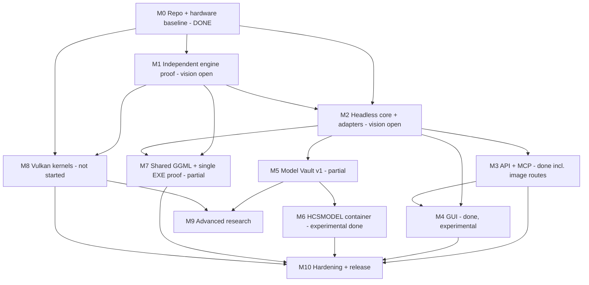

# HCSInfer implementation plan (derived from AGENTS.md section 5)

Checklist legend: `[x]` done with evidence in `docs/test-evidence/` or an inspected test, `[~]` partial,
`[ ]` open. Per-gate status and evidence live in `STATUS.md`. Updated 2026-11-17 from the inspected tree.

## Dependency graph

Critical path to V1: vision adapter -> image routes in API/MCP -> GUI (ADR-009) -> Model Vault in the load path ->
hardening/soak -> release package. M7 single-EXE and M8 kernels gate only the single-file and custom-kernel claims.
Last completed milestone: V1.1 wave 1 (commit `6a390b8`) plus the wave-2 browser demo `web/` (ADR-013) and the HCS
Train pipeline (ADR-012; logic + CLI green, a real training run NOT RUN). Earlier: M3 image routes + M4 embedded UI
+ `benchmark` command + M10 audit fixes (`docs/test-evidence/M3-image`, `M4-gui`, `benchmark`, `M10-fixes`).
Next: the last V1.1 wave-2 item (HCS Agent adapter), then M5 Model Vault in the engine load path.

## M0 Repository and hardware baseline
- [x] Repo inspected, scaffold + build/test scripts
- [x] `src/hardware`: CPU features, RAM, OS build, GPU adapters, Vulkan device/feature/heap report
- [x] `HCSInfer doctor --json`, unknown values reported as `unknown` (`M0/doctor.json`, `doctor-no-vulkan.json`)
- [x] External drive identity + non-destructive read-speed benchmark (`M0/readbench-usb-hdd.json`)
- [x] CPU fallback with Vulkan disabled (`M0/doctor-no-vulkan.json`)
- [~] JSON schema validated: output is tested in `tests/unit/hardware`; no standalone schema file
- [x] llama.cpp / sd.cpp CPU+Vulkan build logs (`M1/`)

## M1 Independent engine proof
- [x] Pin llama.cpp + stable-diffusion.cpp commits in `external/dependency-lock.json`
- [x] llama.cpp Vulkan build, device listing, real GGUF generation from the USB drive (`M1/llama`)
- [~] Real multimodal image analysis: proven through the HCS adapter (SmolVLM2-500M Q8_0 + mmproj, CPU and Vulkan, `M2-vision/`); a standalone upstream `llama-mtmd-cli` run is NOT recorded and the model-file hashes are not in `dependency-lock.json`
- [x] sdcpp Vulkan build, diffusion smoke (SD1.5 Q8_0) (`M1/sd`)
- [x] sdcpp CPU params vs `--params-backend disk` comparison (B7) - `docs/test-evidence/B7-params/` (compute backend separate from parameter backend; disk placement uses ~1.1 GB less and was faster here, but the model is on NVMe, so the USB-HDD case is NOT RUN)
- [x] CPU-only fallback verified for text and diffusion (not for vision)
- [~] CPU/Vulkan baselines B0/B1 recorded but provisional (uncontrolled, 3-5 samples)
- [~] Unsupported model/feature behaviour: clear `Unsupported` errors exist; no documented matrix yet

## M2 Headless core
- [x] C++20 core: Result/Error + exit codes, lifecycle state machine, registry/manifest, JobQueue, MemoryBudget, Settings, PathGuard, logger, engine interfaces
- [x] CLI: `--help` everywhere, `doctor`, `models list|scan|inspect|load|unload`, `chat`, `image generate|edit`, `serve`, `mcp stdio`, `benchmark --suite quick`
- [x] Control-plane facade (`src/api/control_plane.cpp`): registry + JobQueue + engines, model switch unloads the previous model
- [~] Budget checked before eviction: `MemoryBudget` is unit-tested and fed by a live memory probe (`src/hardware/memory_probe.cpp`); verifying it against real engine loads is NOT RUN
- [x] `src/engines/llama` adapter implementing `ITextEngine` (text + vision)
- [x] `src/engines/diffusion` adapter implementing `IImageEngine` (text-to-image, img2img; CPU + Vulkan)
- [~] CLI `tune`, `cache` (exit code 10 today; `benchmark` is implemented)
- [x] Cancellation mid-generation and 10x load/unload on the llama adapter (`M2/llama-engine-integration.txt`); [x] the diffusion adapter has blocking/cancellation integration tests (`DiffusionBlocking.*`)
- [~] ADR-001..004: finalised with the evidence available; open items are listed inside each ADR

## M3 Unified API and MCP
- [x] HTTP: `/v1/models`, `/v1/chat/completions` (+streaming), `/hcs/v1/{health,runtime,devices,memory,models,models/{id},jobs}`
- [x] `/v1/images/generations`, `/v1/images/edits` (real render, `M3-image/` 47/47)
- [ ] `POST /hcs/v1/benchmarks` (`501` today; the CLI `benchmark` command is the supported path)
- [x] Loopback bind, token auth, body limits, request IDs, structured errors, inflight cap (`tests/contract/api*`)
- [x] MCP stdio tools: models list/inspect/load/unload, chat.generate, runtime.status, jobs.status/cancel; stdout clean; real run in `e2e_real.py`
- [x] MCP `hcs.vision.analyze`, `hcs.image.generate`, `hcs.image.edit` (real render, image content block, `M3-image/`)
- [ ] Optional Streamable HTTP (deliberately not implemented; only after Origin validation + conformance tests)
- [x] Malformed/oversized/unauthorised request tests; path-root enforcement tests

## M4 GUI
- [x] ADR-009 toolkit decision (embedded local web UI served by the loopback API) - **accepted and implemented**
- [x] Chat, Vision, Image Studio, Models, Performance, Settings (`src/gui/assets`), Simple/Advanced modes
- [x] Hook wired into `ApiHandler::handle()`; real state from `/hcs/v1/*`, no inert controls; page is static so it renders without an engine
- [x] Unit tests (11 `GuiAssets.*`), contract tests (`ApiUi.*`), e2e over a real socket + a real headless-Chrome boot (`M4-gui/`)
- [~] Normal-user workflow: manually run against real models (recorded in `M4-gui/README.md`), automated playwright phase NOT RUN
- [ ] GUI on a Vulkan build; image edit in the UI (CLI/MCP only today)

## M5 Model Vault v1
- [~] Approved root + path guard + header/size validation exist; full-file hash validation exists in `hcs_storage` (sha256), not in the registry scan
- [~] Async sequential bounded reads implemented and tested in `src/storage`; engines do not load through it yet
- [x] Load modes from upstream capabilities (mmap/mlock/mmap+mlock/none/direct_io) benchmarked on the real HDD model with peak RAM/commit - `docs/test-evidence/M5-loadmodes/`; `--load-mode` exposed by `benchmark` and `vision` as well
- [ ] Stage B: bounded async read pipeline feeding the engine, cold vs warm on a storage-bound model (B4/B8) - BLOCKED on this machine (no model larger than RAM, no admin rights to flush the file cache)
- [~] No HCS-owned decompressed SSD cache (design + code have none; ADR-005); USB-disconnect test NOT RUN
- [x] Page-file caveat documented (`docs/model-vault.md`)

## M6 HCSMODEL container (experimental)
- [x] Versioned header/chunk table, checked arithmetic, Raw/LZ4/Zstd, per-chunk hashes, random access
- [x] Malformed/mutation tests; [~] libFuzzer only a 60 s UBSan smoke
- [~] Chunk-size benchmark JSON exists for one model; a net throughput benefit on the HDD is not proven (B5/B6 not a claim)

## M7 Shared GGML ABI + single EXE
- [x] `SD_USE_UPSTREAM_GGML=ON` builds, matches patched output for SD1.5; HCSInfer links one GGML for both engines
- [ ] Operator coverage vs patched for Flux/DiT/Qwen-Image/FP8/INT8 models
- [ ] Static CRT, embedded assets, one EXE, clean-machine test (ADR-008). Portable folder package via `scripts/package.ps1` is the interim deliverable

## M8 Vulkan kernels (one at a time, feature-flagged)
- [ ] Profile upstream; per-kernel CPU reference, validation layers, SPIR-V validation, benchmark vs upstream, fallback
- [ ] Order: quantized GEMV, GEMM, fused dequant+matmul, RMSNorm/residual, RoPE, SwiGLU, attention/KV, diffusion conv/attention/VAE
- [ ] Autotuner/kernel registry cache with correctness gate

## M9 Advanced research (after V1 baseline)
- [ ] Paged KV cache, KV quant profiles, tiled attention, adaptive CPU/GPU scheduling, speculative decoding, diffusion tiling
- [ ] Each with research note, flag, correctness + performance tests

## M10 Hardening and release
- [x] Security audit D1-D7: deep-JSON stack guard, connection budget/starvation, abandoned-request cancellation, runaway-job cap, reserved Windows device names, duplicate security headers, loopback literal parsing (`M10-fixes/`)
- [ ] Soak (100 load/unload, 30 min generation), long fuzz (ASan), OOM/device-lost/HDD-unplug injection
- [~] SBOM (`scripts/sbom.ps1`), checksums (`scripts/package.ps1`), notices (`THIRD_PARTY_NOTICES.md`) created; not yet run in release CI
- [ ] Signed build, release notes, support matrix, clean-machine quick start

## Cross-cutting ADRs
- [x] 001 GGML topology (accepted with scope limits); 002 process model; 003 Vulkan ownership; 004 memory budget (accepted with open validation items)
- [x] 005 Vault/no-SSD cache; 006 chunk container; 007 API/MCP security
- [x] 008 static CRT (decision: deferred, evidence plan); 009 GUI (accepted and implemented); 010 benchmark methodology (accepted, first B0 run recorded)

## CI
- [x] `.github/workflows/pr.yml`: windows-latest configure/build/ctest + format check (created; never executed, repo has no commits or remote)
- [x] `.github/workflows/hardware.yml`: self-hosted Radeon runner, manual dispatch / trusted branch only (created; never executed)
- [ ] First green hosted run; first hardware run on the self-hosted runner

## M11 V1.1 (2026-11-17 addendum, see AGENTS.md section 26)
- [x] Wave 1: FLUX.3 Klein engine + step presets, LFM3-Omni Q8 default LLM + tool calls + agentic eval, HCS Studio UI, prime-agent/train foundations (commit `6a390b8`)
- [~] Wave 2: `web/` browser WebGPU/WASM demo (ADR-013) **done** - shell + logic green (46 tests, 14 e2e checks on a real headless Chrome), real WebGPU inference NOT RUN, Vercel deploy NOT RUN; HCS Train pipeline + eval gate + adapter book + `train` CLI (ADR-012) **done** - logic + CLI green (30 new tests), a real training run NOT RUN; HCS Agent adapter `[ ]`
- [ ] Wave 3: RSI loop, single-EXE/packaging, soak + hardening, V1 stable release candidate
- Merge to `main` after each green wave.
